# Groups Chat — Arquitetura Base da V1

> **Especificação técnica dos módulos estruturais da aplicação**<br>
> **Versão do documento:** 1.0<br>
> **Última atualização:** 17 de novembro de 2026<br>
> **Escopo:** arquitetura macro, identidade e autenticação, bootstrap da API, configurações da instância, bootstrap do cliente Tauri, descoberta e conexão em tempo real.<br>
> **Estado:** arquitetura-base definida; contratos de referência sujeitos à padronização indicada neste documento.

## 0. Escopo, módulos e convenções do documento

Este documento especifica a **arquitetura estrutural do Groups Chat V1** e os contratos compartilhados entre os módulos da aplicação. Ele orienta a implementação do servidor self-hosted, do cliente desktop e dos serviços de comunicação, além de estabelecer as interfaces que os módulos de negócio utilizarão. Cada módulo pode ser desenvolvido e detalhado separadamente, desde que respeite os contratos, invariantes e limites de responsabilidade apresentados aqui.

Os requisitos e contratos estão classificados assim:

- **[DEFINIDO]** Comportamento ou restrição incorporado à arquitetura-base.
- **[REFERÊNCIA V1]** Contrato inicial recomendado para a V1; sua semântica é a referência técnica, embora a nomenclatura, a validação e a compatibilidade possam exigir padronização.
- **[PARÂMETRO SUGERIDO]** Valor inicial recomendado, não uma regra imutável.
- **[PENDENTE]** Deve ser especificado em um módulo futuro ou antes do início da implementação correspondente.
- **[FORA DO ESCOPO V1]** Funcionalidade ou abordagem que não integra os requisitos desta versão.

**Importante:** diagramas e pseudocontratos usam nomes conceituais. As regras e os contratos funcionais da API são **agnósticos a linguagem, framework e implementação de persistência**; Tauri, LiveKit e PostgreSQL aparecem de forma explícita por serem componentes da arquitetura de implantação da V1. Os exemplos JSON adotam `camelCase` como convenção de referência. **Os DTOs e o schema OpenAPI devem seguir uma convenção única antes da implementação**.

### 0.1 Mapa de módulos da aplicação

| Camada | Módulo | Responsabilidade principal | Situação na V1 |
|---|---|---|---|
| Servidor | **Bootstrap da API** | Provisionar instância e conta MASTER de forma atômica e idempotente | Especificado neste documento |
| Servidor | **Identidade e autenticação** | Usuários locais, papéis, credenciais, sessões, emissão, renovação e revogação de tokens | Especificado neste documento |
| Servidor | **Configuração da instância** | Identidade pública, política de ingresso e parametrização administrativa | Especificado neste documento |
| Servidor | **Descoberta da instância** | Expor identidade, recursos, protocolo e endpoints públicos ao desktop | Especificado neste documento |
| Servidor | **Transporte em tempo real** | Estabelecer e manter WebSockets autenticados por instância | Especificação estrutural neste documento |
| Cliente Tauri | **Bootstrap e gerenciamento de instâncias** | Cadastrar servidores, descobrir metadados e restaurar conexões isoladas | Especificado neste documento |
| Cliente Tauri | **Credenciais e sessões locais** | Proteger refresh tokens, restaurar acessos e sincronizar estados da UI | Especificado neste documento |
| Infraestrutura | **Gateway, persistência e LiveKit** | Roteamento TLS, armazenamento durável e infraestrutura de mídia | Limites e integrações especificados |
| Negócio | **Ingresso e administração de usuários** | Aprovações, convites, moderação e atribuição de papéis | Especificação complementar |
| Negócio | **Workspaces, canais e mensagens** | Organização de comunidades, autorização por recurso, persistência e entrega de conteúdo | Especificação complementar |
| Comunicação | **Presença, voz e compartilhamento de tela** | Presença, salas de mídia, tokens LiveKit e eventos de sessão | Especificação complementar |
| Operação | **Notificações e observabilidade** | Alertas, eventos, métricas, rastreamento e suporte operacional | Especificação complementar |

Os módulos podem ser organizados em pacotes internos de um monólito modular no servidor. A divisão acima é **funcional**, não uma exigência de que cada módulo execute como serviço independente.

---

## Índice

- [0. Escopo, módulos e convenções do documento](#0-escopo-módulos-e-convenções-do-documento)
- [1. Visão geral](#1-visão-geral)
- [2. Arquitetura macro e limites entre serviços](#2-arquitetura-macro-e-limites-entre-serviços)
- [3. Modelo de identidade, autorização e dados-base](#3-modelo-de-identidade-autorização-e-dados-base)
- [4. Bootstrap inicial da API](#4-bootstrap-inicial-da-api)
- [5. Identidade e autenticação — regras comuns](#5-identidade-e-autenticação--regras-comuns)
- [6. Contratos HTTP de autenticação](#6-contratos-http-de-autenticação)
- [7. Configurações da instância](#7-configurações-da-instância)
- [8. Bootstrap do cliente desktop Tauri](#8-bootstrap-do-cliente-desktop-tauri)
- [9. API de conexão em tempo real](#9-api-de-conexão-em-tempo-real)
- [10. Contratos e integrações entre módulos](#10-contratos-e-integrações-entre-módulos)
- [11. Padrão de respostas, erros e versionamento](#11-padrão-de-respostas-erros-e-versionamento)
- [12. Segurança e operação](#12-segurança-e-operação)
- [13. Critérios de aceitação da arquitetura-base](#13-critérios-de-aceitação-da-arquitetura-base)
- [14. Itens previstos para especificações de módulos complementares](#14-itens-previstos-para-especificações-de-módulos-complementares)
- [15. Limites arquiteturais e exclusões da V1](#15-limites-arquiteturais-e-exclusões-da-v1)
- [16. Requisitos de integração para novos módulos](#16-requisitos-de-integração-para-novos-módulos)

---

## 1. Visão geral

### 1.1 Propósito

O Groups Chat é uma aplicação **desktop, self-hosted e multi-instância**, destinada à comunicação entre usuários por mensagens de texto, voz e compartilhamento de tela. Cada organização/comunidade pode hospedar sua própria instância de servidor. Um mesmo cliente desktop deve poder cadastrar, autenticar-se e se conectar a várias dessas instâncias.

### 1.2 Princípios da V1

1. **Independência:** cada instância tem sua própria identidade, usuários, credenciais, papéis, sessões, configuração, dados e infraestrutura lógica.
2. **Sem identidade global:** um `username` na instância A não corresponde automaticamente ao mesmo `username` na instância B.
3. **Cliente multi-instância:** cada conexão é administrada separadamente, sem derrubar as demais ao trocar a instância em foco.
4. **Monólito modular na aplicação:** autenticação, usuários, administração, mensagens e autorização são domínios de uma aplicação de servidor inicialmente única.
5. **Separação de planos:** mensagens e metadados percorrem a API/WebSocket da aplicação; áudio/vídeo/tela percorrem WebRTC/LiveKit.
6. **Persistência real:** o banco principal é a fonte de verdade de usuários, sessões, configurações, permissões e histórico de mensagens.
7. **Inicialização previsível:** o MASTER é criado uma única vez, no primeiro boot, a partir de variáveis de ambiente.
8. **Autorizações no servidor:** a interface nunca é responsável por garantir sozinha permissões administrativas ou de canais.
9. **Transporte seguro:** HTTPS/WSS e proteção dos tokens são requisitos de produção.
10. **Escopo reduzido:** preservar uma base simples para evoluir os módulos de comunicação sem introduzir federação, SSO ou plataforma centralizada prematuramente.

### 1.3 O que não existe nesta versão-base

Não haverá cadastro por e-mail, telefone, login social ou identidade federada; não há servidor central do Groups Chat para registrar ou autenticar usuários de todas as instâncias; não há necessidade de um serviço TURN separado do LiveKit no MVP; nem setup público, token de reivindicação ou tela de criação do MASTER na primeira inicialização. Recursos como convites, aprovação administrativa, workspaces, canais, mensagens e chamadas possuem interfaces com esta base, mas terão documentação de domínio própria.

### 1.4 Decisões rápidas

| Tema | Definição atual | Estado |
|---|---|---|
| Cliente | Desktop com Tauri, múltiplas instâncias | **[DEFINIDO]** |
| Servidor de aplicação | Monólito modular por instância | **[DEFINIDO]** |
| Gateway | Reverse proxy para API HTTPS e WebSocket WSS | **[DEFINIDO]** |
| Voz e compartilhamento | LiveKit SFU, processo/serviço separado | **[DEFINIDO]** |
| Transporte de mídia | WebRTC direto ou por TURN/ICE; não passa pelo gateway HTTP comum | **[DEFINIDO]** |
| TURN | Recursos integrados ao LiveKit inicialmente | **[DEFINIDO]** |
| Banco principal | PostgreSQL como fonte de verdade no desenho macro | **[DEFINIDO]** |
| Redis | Opcional na aplicação inicialmente; pode ser necessário ao escalar o LiveKit | **[REFERÊNCIA V1]** |
| Contas | Locais a cada instância; `username` + senha | **[DEFINIDO]** |
| Papéis | `MASTER`, `ADMIN`, `MEMBER` | **[DEFINIDO]** |
| Sessões | Persistentes, independentes, revogáveis; access + refresh opacos | **[DEFINIDO]** |
| Bootstrap da API | Variáveis de ambiente, de maneira idempotente e atômica | **[DEFINIDO]** |
| Políticas de ingresso | `PUBLIC`, `APPROVAL_REQUIRED`, `CLOSED` | **[DEFINIDO]** |
| Configurações V1 | `name`, `description`, `icon`, `joinPolicy` | **[DEFINIDO]** |
| Descoberta do cliente | `GET /instance/info`, antes das credenciais | **[DEFINIDO]** |
| Canal de eventos | WebSocket da aplicação em `/realtime` | **[REFERÊNCIA V1]** |
| Armazenamento local | SQLite + cofre seguro do sistema operacional; access token na memória | **[DEFINIDO]** |

---

## 2. Arquitetura macro e limites entre serviços

### 2.1 Diagrama lógico

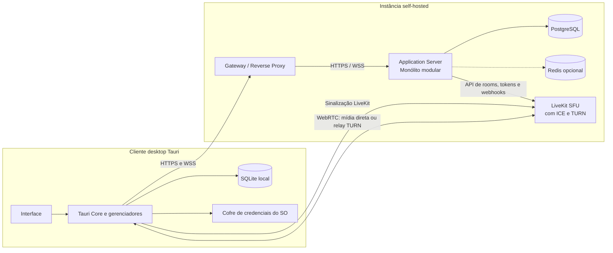

O traço entre cliente e LiveKit representa apenas o plano de mídia/sinalização do LiveKit. O gateway pode encaminhar o endpoint HTTPS/WSS de sinalização do LiveKit conforme o deployment, **mas não deve ser confundido com o caminho dos pacotes de mídia WebRTC**.

### 2.2 Uma instalação; várias identidades no cliente

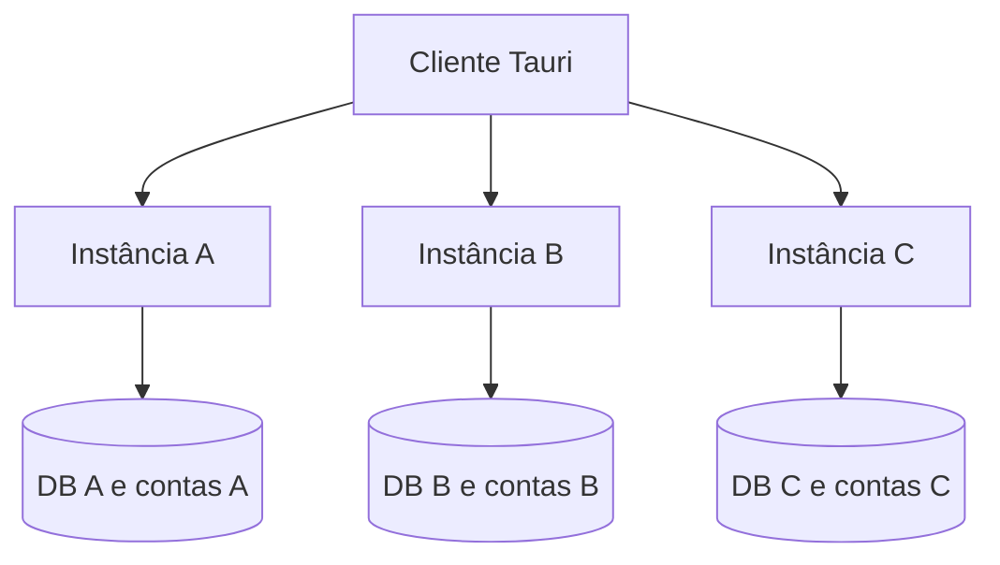

- Uma instalação Tauri pode conter três instâncias cadastradas e três sessões diferentes.
- Revogar a sessão em A **não** invalida a sessão em B.
- Uma indisponibilidade em B não bloqueia conexões em A e C.
- A URL cadastrada é o ponto de entrada para descoberta; a identidade estável do servidor é o `remoteInstanceId` fornecido pelo próprio servidor.

### 2.3 Responsabilidades

| Componente | Responsabilidade | Não deve fazer |
|---|---|---|
| Tauri UI | Apresentação, navegação, comandos do usuário | Guardar senha ou refresh token em armazenamento comum |
| Tauri Core | Descoberta, sessões, conexões, reconexão, armazenamento seguro | Compartilhar tokens entre instâncias |
| Gateway | TLS, roteamento HTTP/WSS, cabeçalhos, limites de infraestrutura | Tratar áudio/vídeo como se fossem requisições HTTP convencionais |
| Application Server | Autenticação, autorização, regras de negócio, texto, histórico, presença/eventos | Fazer SFU de mídia |
| PostgreSQL | Persistência principal de contas, configurações, sessões, mensagens | Ser substituído por cache como fonte da verdade |
| Redis (se adotado) | Cache, presença transitória, pub/sub, coordenação | Armazenar unicamente informações que não podem ser perdidas |
| LiveKit | SFU, transporte de mídia, conexões WebRTC, ICE/TURN | Ser a base de dados de mensagens de texto persistentes |

### 2.4 Limite entre texto e mídia

**Mensagens de texto**: cliente → WebSocket da aplicação → autorização → persistência → distribuição para destinatários. Recuperação de histórico por API a definir no módulo de mensagens.

**Voz/tela**: cliente autenticado → backend verifica permissão → backend concede credencial de sala LiveKit com curta validade → cliente se conecta ao LiveKit via WebRTC → LiveKit entrega eventos relevantes ao backend por webhooks. O backend valida a autenticidade e processa webhooks de forma idempotente.

### 2.5 TURN explicado

TURN é um **relay de mídia**, acionado quando NAT, firewalls ou a rede impedem conexão WebRTC direta. O mecanismo ICE seleciona um caminho viável. Para o MVP, utilizar os mecanismos integrados ao LiveKit é suficiente. Não é necessário iniciar com um servidor Coturn separado. Em produção, endereços, portas UDP/TCP, TLS e certificados devem ser tratados no desenho de deployment, não apenas na configuração do gateway.

### 2.6 Endereçamento sugerido de deploy

Exemplo ilustrativo, não obrigatório:

```text
https://api.comunidade.example       -> API e /realtime
wss://api.comunidade.example/realtime -> Eventos da aplicação
wss://rtc.comunidade.example         -> Sinalização LiveKit
turn.comunidade.example              -> Relay TURN, quando necessário
```

**[PENDENTE]** Escolher o padrão definitivo de domínios, exposição de portas e implantação local/LAN. O contrato de descoberta deve evitar que o cliente precise conhecer previamente a topologia interna da instância.

---

## 3. Modelo de identidade, autorização e dados-base

### 3.1 Usuários e escopo

Cada usuário pertence a uma **única instância**; usuários de instâncias diferentes não compartilham `id`, sessões nem papel. Uma pessoa real pode criar contas independentes com o mesmo `username` e senhas diferentes em servidores distintos.

O cadastro e o login usam **somente `username` e `password`**. Não existe campo de e-mail ou telefone na V1.

**Regras de username [REFERÊNCIA V1]:**

- Identificador normalizado de forma canônica e comparado sem diferenciar maiúsculas/minúsculas;
- Comprimento de **3 a 32 caracteres**, ASCII, com letras, dígitos e `_`, `-`, `.`;
- Unicidade protegida por restrição persistente, não apenas por uma consulta prévia;
- Normalização aplicada igualmente no cadastro, login, bootstrap e procura;
- Preserve `username` de apresentação caso seja útil, mas tenha uma chave canônica única.

**Regras de senha [REFERÊNCIA V1]:** mínimo de 15 caracteres, aceitar senhas longas (ao menos 64 caracteres), não exigir combinações artificiais de classes, gerar hash robusto com salt exclusivo e parâmetros que possam ser atualizados. Senhas nunca são registradas em logs nem armazenadas em texto puro.

### 3.2 Papéis

| Papel | Forma de obtenção | Responsabilidades na base |
|---|---|---|
| `MASTER` | Criado exclusivamente no primeiro bootstrap | Proprietário único; administra configurações globais e administração da instância |
| `ADMIN` | Concedido por mecanismo administrativo a especificar | Moderação/administração operacional, inclusive aprovação de ingresso quando implementada |
| `MEMBER` | Papel padrão dos usuários comuns | Uso autorizado de funcionalidades da instância |

**Invariantes:** existe **exatamente um MASTER por instância inicializada**. A identidade de proprietário deve ter referência estável em `Instance.ownerUserId` (ou equivalente) e não depender apenas de um texto editável de `role`. Nunca há registro público ou endpoint normal que crie outro MASTER. A autorização completa de salas, canais e workspaces terá regras específicas de recurso, **além** do papel global (RBAC).

### 3.3 Estado de usuário

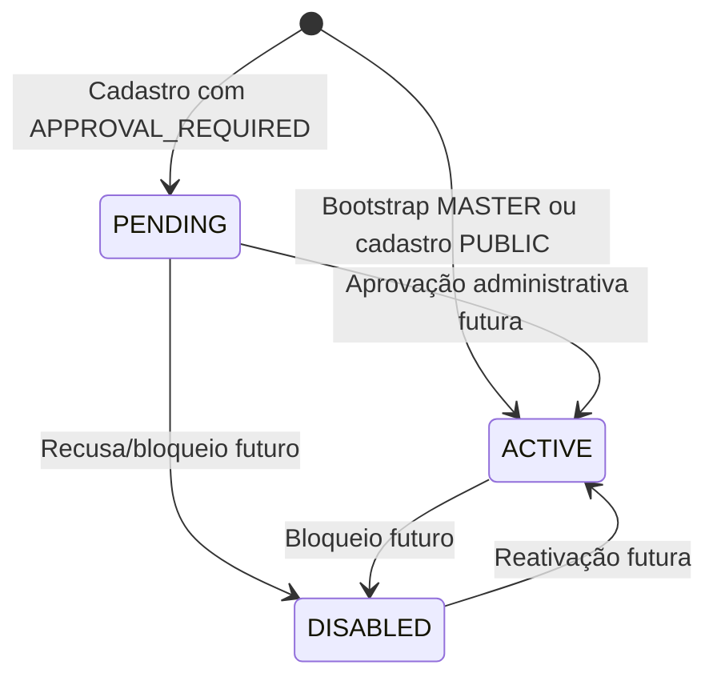

- `ACTIVE`: pode autenticar-se, sujeito às permissões.
- `PENDING`: aguarda aprovação; **não recebe tokens/sessões**.
- `DISABLED`: não pode estabelecer ou manter novas sessões válidas.

O mecanismo de aprovar, recusar ou reativar solicitações **ainda não integra as rotas-base documentadas**. Os estados `DISABLED` e seus fluxos administrativos são referências para compatibilidade futura.

### 3.4 Modelagem conceitual

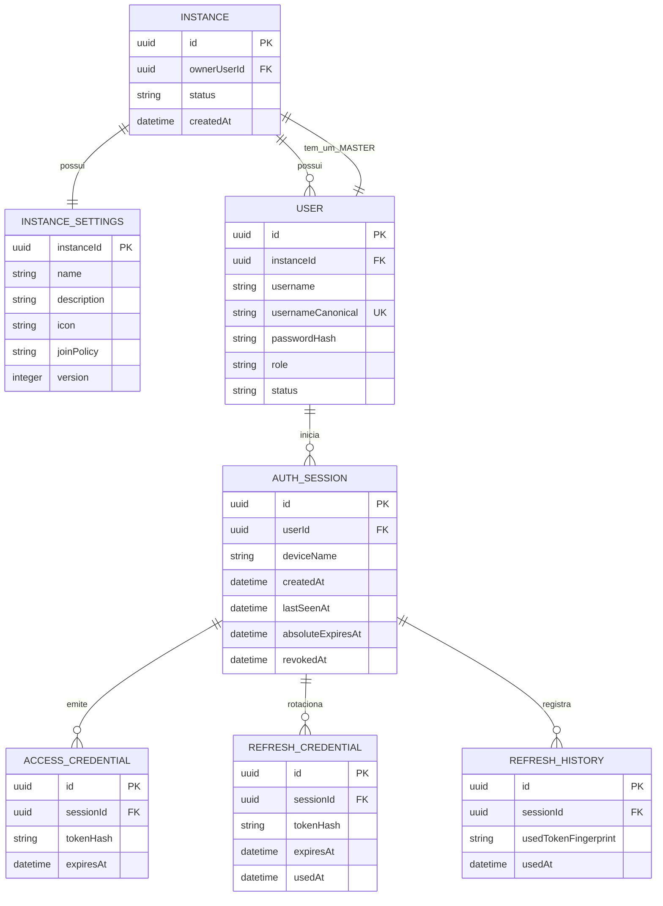

O diagrama expressa **conceitos, não tabelas obrigatórias**. Implementações podem embutir credenciais ou histórico em outras estruturas, desde que mantenham: unicidade, sessões revogáveis, uso único de refresh, detecção de reuso, auditoria mínima e operações atômicas.

### 3.5 Estados da instância

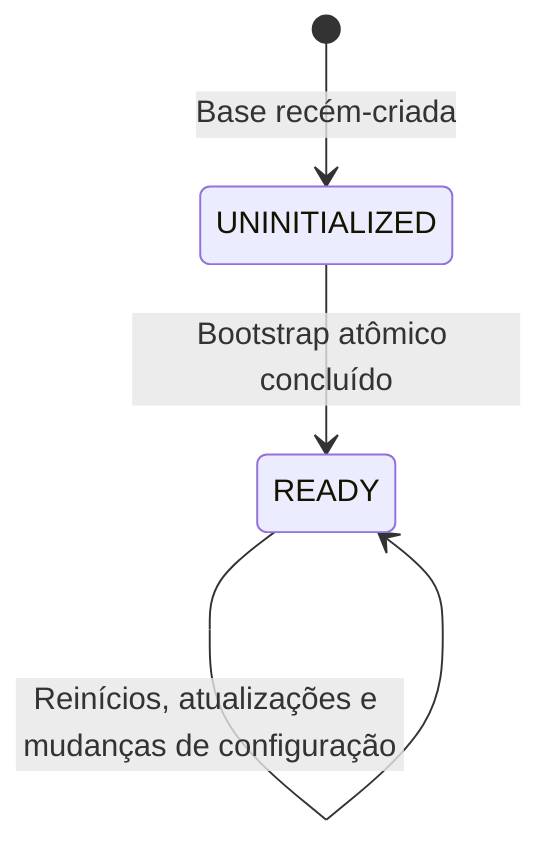

- `UNINITIALIZED`: ainda não há MASTER nem configuração inicial concluída; **não liberar a API de negócio**.
- `READY`: `MASTER`, proprietário e configuração inicial já persistidos.
- Não há transição de volta para `UNINITIALIZED` pela API nem por variáveis de ambiente.

---

## 4. Bootstrap inicial da API

### 4.1 Decisão definitiva

**[DEFINIDO]** O módulo de bootstrap do servidor utiliza **exclusivamente variáveis de ambiente** na primeira inicialização, em um ambiente administrado pelo operador. O fluxo segue um modelo de provisionamento administrativo inicial semelhante ao utilizado por soluções como o Keycloak.

| Variável | Obrigatória antes do primeiro bootstrap | Função |
|---|---|---|
| `BOOTSTRAP_MASTER_USERNAME` | Sim | `username` do MASTER inicial |
| `BOOTSTRAP_MASTER_PASSWORD` | Sim | Senha inicial do MASTER |
| `BOOTSTRAP_INSTANCE_NAME` | Sim | Nome público inicial da instância |

Uma vez em `READY`, **essas variáveis deixam de ter efeito**, mesmo que continuem configuradas ou sejam alteradas. Recomenda-se removê-las do ambiente após o primeiro boot, especialmente a senha.

### 4.2 Algoritmo de inicialização

1. Iniciar dependências essenciais e verificar/migrar o esquema persistente.
2. Consultar o estado persistido da instância.
3. Se `READY`, iniciar normalmente sem recriar usuário e **sem reler variáveis como instruções administrativas**.
4. Se `UNINITIALIZED`, ler as três variáveis, validar nome, username e senha.
5. Abrir transação com controle para concorrência entre réplicas.
6. Criar a instância, a configuração padrão, o usuário com hash seguro, referenciar `ownerUserId` e registrar `READY` **na mesma unidade atômica**.
7. Confirmar a transação e habilitar os endpoints de negócio.
8. Se ocorrer falha, não deixar MASTER sem instância, nem instância READY sem MASTER; o novo boot poderá tentar novamente.

### 4.3 Fluxo do bootstrap

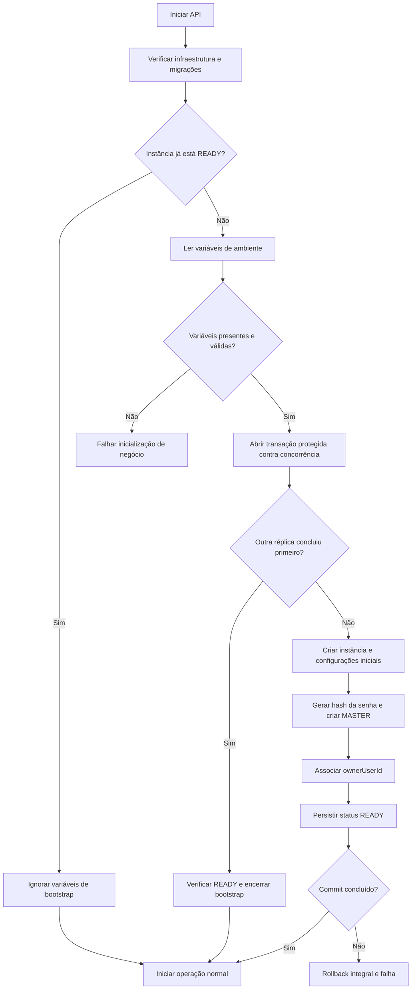

### 4.4 Configuração inicial

- `name`: lido de `BOOTSTRAP_INSTANCE_NAME`.
- `description`: vazio/nulo, até ser alterado.
- `icon`: vazio/nulo, até ser alterado.
- `joinPolicy`: **`APPROVAL_REQUIRED` como valor padrão recomendado para a V1**.
- `ownerUserId`: usuário MASTER criado pela transação.
- `status`: `READY` apenas quando tudo tiver sido persistido.

**[REFERÊNCIA V1]** `APPROVAL_REQUIRED` no primeiro boot é o default da especificação de configurações. Pode ser posteriormente alterado pelo MASTER sem reiniciar o servidor.

### 4.5 Regras de confiabilidade

- **Idempotência:** reiniciar não cria novo MASTER, instância nem redefine senha.
- **Atomicidade:** a transação cobre instância, OWNER e configurações.
- **Concorrência:** duas réplicas iniciadas juntas não podem produzir dois MASTERs.
- **Não recuperação por bootstrap:** após `READY`, mudar variáveis de ambiente não é uma forma de resetar a senha.
- **Segredos operacionais:** nunca imprimir a variável de senha nos logs; minimizar sua permanência no deployment.
- **Fail closed:** sem dados válidos no primeiro boot, a aplicação não disponibiliza rotas de negócio como se estivesse pronta.

### 4.6 Interfaces não disponibilizadas pelo módulo

**[FORA DO ESCOPO V1]** O módulo de bootstrap **não expõe** `/setup/status`, `/setup/complete`, sessão temporária de configuração, `INITIAL_SETUP`, código/token de reivindicação ou assistente web/desktop para criação do MASTER. O provisionamento inicial é uma operação interna da inicialização da API. A recuperação de acesso à conta MASTER requer um procedimento administrativo seguro, a ser especificado no módulo de gestão de identidade.

---
## 5. Identidade e autenticação — regras comuns

### 5.1 Separação entre conta, sessão e conexão

- **Conta (`User`)**: identidade persistente daquela instância; tem username, hash da senha, papel e estado.
- **Sessão (`AuthSession`)**: autorização persistente associada a um dispositivo/login; pode sobreviver ao fechamento do cliente e ser revogada de maneira independente.
- **Access token**: credencial opaca, de curta duração, usada nas rotas autenticadas e no estabelecimento de conexões da aplicação.
- **Refresh token**: credencial opaca, de uso único por rotação, mantida no cofre para obter novo access token.
- **Conexão WebSocket**: canal de eventos estabelecido usando uma sessão válida, mas **não substitui nem é a sessão em si**.
- **Token LiveKit**: credencial independente e limitada para uma sala/participação de mídia; é emitida a partir de uma autenticação válida do backend.

### 5.2 Política de tokens e expiração

**[DEFINIDO]** Access e refresh tokens são opacos, gerados de forma criptograficamente segura; o backend armazena identificadores/verificadores protegidos (preferencialmente hashes), não os tokens em claro. Sessões permanecem persistidas e são revogáveis. Refresh tokens rotacionam e **cada valor só pode ser utilizado uma vez**; reutilização de token antigo deve ser tratada como incidente e revogar a sessão afetada.

| Parâmetro | Valor inicial apresentado | Status |
|---|---|---|
| Duração do access token | 15 minutos (`900` segundos) | **[PARÂMETRO SUGERIDO]** |
| Expiração por inatividade da sessão | 30 dias | **[PARÂMETRO SUGERIDO]** |
| Vida absoluta da sessão | 90 dias | **[PARÂMETRO SUGERIDO]** |
| Refresh token | Rotação a cada uso bem-sucedido | **[DEFINIDO]** |
| Reutilização de refresh antigo | Revogar sessão afetada | **[DEFINIDO]** |
| Logout/revogação | Impedir novos acessos/conexões; invalidar canais ativos | **[DEFINIDO]** |

O tempo de access token limita a janela sem uma consulta ao estado da sessão, **mas a revogação imediata exige verificação do estado da sessão ou mecanismo equivalente**. Não basta confiar exclusivamente no TTL de uma credencial já emitida.

### 5.3 Middleware autenticado compartilhado

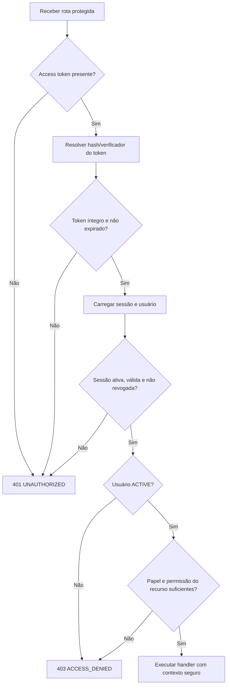

Esta verificação é conceitual: middleware pode adiar a autorização específica do recurso ao serviço/domínio responsável. A regra continua sendo **autenticar primeiro e autorizar por ação/recurso depois**.

### 5.4 Controles transversais

1. TLS de ponta a ponta onde aplicável; nunca trafegar tokens por HTTP simples em produção.
2. Limitar tentativas de login, cadastro e refresh; considerar bloqueios progressivos sem permitir enumeração fácil de usuários.
3. Resposta de credenciais inválidas é genérica: não revelar se o username existe.
4. Impor unicidade do username no armazenamento persistente e capturar conflitos concorrentes.
5. Rotação de refresh deve ser atômica, de modo que duas requisições simultâneas usando o mesmo token não tenham ambas sucesso.
6. O cliente deve centralizar refresh por instância (*single-flight*) para reduzir colisões acidentais.
7. Não registrar passwords, access tokens, refresh tokens e credenciais LiveKit em log, URL ou telemetria.
8. Mudanças de estado do usuário, bloqueio e revogação precisam repercutir nas conexões em tempo real.
9. Tokens jamais são aceitos entre duas instâncias apenas porque coincidem em formato ou nome de usuário.

---

## 6. Contratos HTTP de autenticação

### 6.1 Inventário

| Método | Rota | Autenticação | Responsabilidade |
|---|---|---|---|
| `POST` | `/auth/register` | Não | Solicitar/criar conta `MEMBER` conforme `joinPolicy` |
| `POST` | `/auth/login` | Não | Verificar credenciais e iniciar sessão |
| `POST` | `/auth/refresh` | Refresh token | Rotacionar credenciais e manter sessão |
| `POST` | `/auth/logout` | Sessão atual / refresh | Encerrar sessão atual |
| `GET` | `/auth/me` | Access token | Retornar usuário autenticado |
| `GET` | `/auth/sessions` | Access token | Listar sessões do próprio usuário |
| `DELETE` | `/auth/sessions/{id}` | Access token | Revogar uma sessão própria |
| `POST` | `/auth/logout-all` | Access token | Revogar todas as sessões do próprio usuário |

### 6.2 `POST /auth/register`

**Objetivo:** criar um usuário `MEMBER` ou registrar sua solicitação de ingresso. A decisão de habilitar acesso pertence à política atual da instância.

**Entrada de referência:**

```json
{
  "username": "marina",
  "password": "uma-senha-forte-e-longa"
}
```

**Comportamento por política:**

| `joinPolicy` | Efeito | Sessão/tokens |
|---|---|---|
| `PUBLIC` | Cria `MEMBER` com status `ACTIVE` | **Não emite tokens no cadastro**; login é operação separada |
| `APPROVAL_REQUIRED` | Cria `MEMBER` com status `PENDING` | Não emite tokens; aguarda aprovação |
| `CLOSED` | Recusa a criação de conta pública | Não emite tokens |

**Saída de referência em `PUBLIC` — `201 Created`:**

```json
{
  "user": {
    "id": "usr_01",
    "username": "marina",
    "role": "MEMBER",
    "status": "ACTIVE",
    "createdAt": "2026-11-17T14:00:00Z"
  }
}
```

Para `APPROVAL_REQUIRED`, a resposta pode indicar `202 Accepted` e `status: "PENDING"` **[REFERÊNCIA V1 — padronizar status e envelope]**. Para `CLOSED`, usar resposta de recusa (`403`, código `REGISTRATION_CLOSED`). Rejeitar username inválido/senha inadequada, nomes duplicados e abuso por rate-limit.

**Fluxo detalhado:**

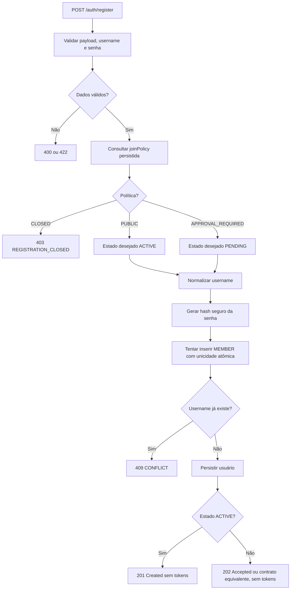

**Invariantes:** nunca permitir criar `ADMIN`/`MASTER` por payload; não confiar na política enviada pelo cliente; fazer o check no servidor na operação real; não criar sessão implicitamente.

### 6.3 `POST /auth/login`

**Objetivo:** iniciar uma nova sessão de dispositivo depois de validar username, senha e estado da conta.

**Entrada de referência:**

```json
{
  "username": "marina",
  "password": "uma-senha-forte-e-longa",
  "deviceName": "Notebook pessoal"
}
```

**Resposta de referência — `200 OK`:**

```json
{
  "user": {
    "id": "usr_01",
    "username": "marina",
    "role": "MEMBER",
    "status": "ACTIVE"
  },
  "session": {
    "id": "ses_01",
    "accessToken": "opaque_access_token",
    "refreshToken": "opaque_refresh_token",
    "accessExpiresIn": 900
  }
}
```

> Esses tokens são **placeholders explicativos**. O formato real será aleatório e criptograficamente seguro. Não apresentar ou registrar esses dados fora do retorno seguro ao cliente.

**Fluxo detalhado:**

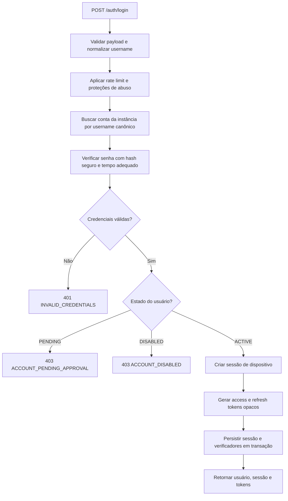

O cliente não persiste senha. `deviceName` é metadado não confiável e deve ter tamanho limitado/sanitizado. `APPROVAL_REQUIRED` impede novas contas de entrar diretamente, **não desloga usuários ACTIVE já aprovados**. A política `CLOSED` impede novos cadastros públicos, não necessariamente login de contas previamente autorizadas.

### 6.4 `POST /auth/refresh`

**Objetivo:** renovar a sessão usando o **refresh token atual, de uso único**.

**Entrada:**

```json
{
  "refreshToken": "opaque_refresh_token"
}
```

**Resposta de referência:**

```json
{
  "session": {
    "id": "ses_01",
    "accessToken": "new_opaque_access_token",
    "refreshToken": "new_opaque_refresh_token",
    "accessExpiresIn": 900
  }
}
```

**Fluxo detalhado:**

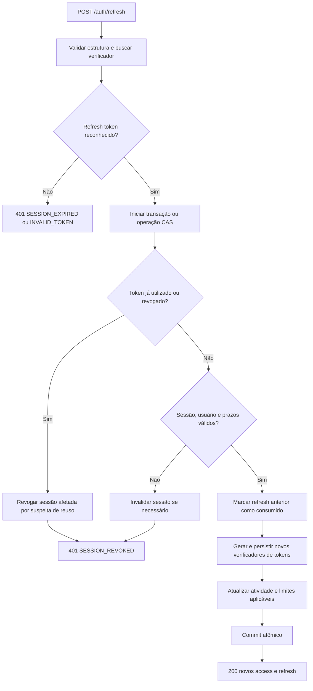

O refresh **não cria uma segunda sessão**: mantém o vínculo com a sessão existente. Em falha de rede após o servidor ter feito o commit, o cliente não deve repetir indefinidamente um token possivelmente consumido; tratamento de recuperação de rotação e política de tolerância a concorrência são **[PENDENTE]**. A exigência de impedir sucesso duplo e detectar reuso permanece.

### 6.5 `POST /auth/logout`

**Objetivo:** encerrar a sessão atual, incluindo seus tokens e conexões em tempo real.

**Entrada:** sessão atual por credencial autenticada; o contrato inicial também admitia identificar a sessão via refresh token. **[PENDENTE]** Fechar a forma exata de transporte sem enfraquecer a revogação.

**Sucesso:** `204 No Content`.

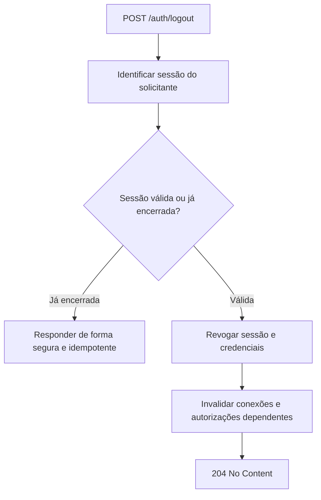

O cliente apaga o refresh token do cofre e limpa o access token em memória independentemente de a UI continuar aberta. Se não houver resposta do servidor, deve tratar a sessão local com cautela e exibir estado coerente, sem alegar que uma revogação remota foi confirmada.

### 6.6 `GET /auth/me`

**Objetivo:** retornar a identidade atual a partir da sessão, nunca a partir de um `userId` confiado ao cliente.

**Resposta de referência:**

```json
{
  "id": "usr_01",
  "username": "marina",
  "role": "MEMBER",
  "status": "ACTIVE"
}
```

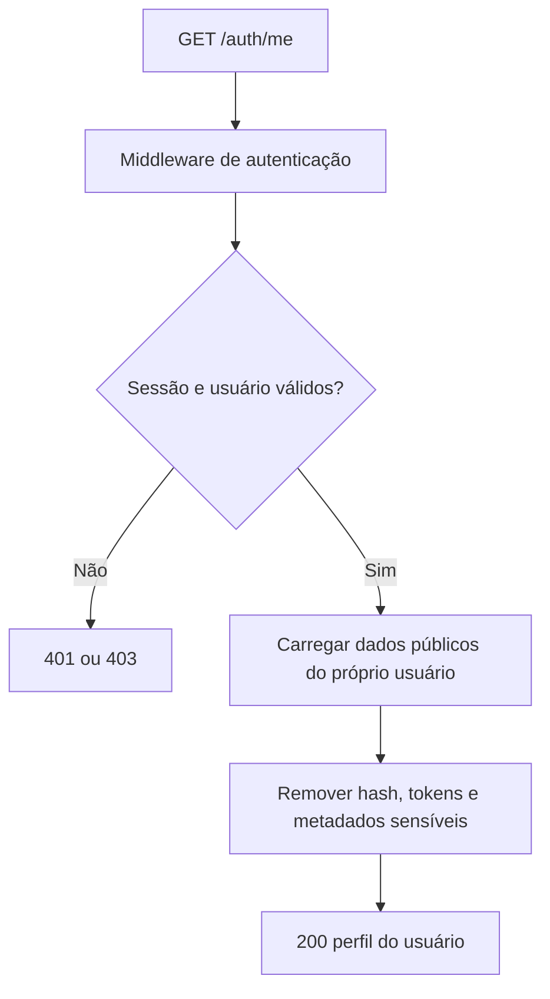

### 6.7 `GET /auth/sessions`

**Objetivo:** listar sessões existentes **do próprio usuário**, informando qual está ativa no dispositivo atual.

**Resposta de referência:**

```json
{
  "sessions": [
    {
      "id": "ses_01",
      "deviceName": "Notebook pessoal",
      "createdAt": "2026-11-17T14:00:00Z",
      "lastSeenAt": "2026-11-17T14:20:00Z",
      "current": true
    },
    {
      "id": "ses_02",
      "deviceName": "Computador secundario",
      "createdAt": "2026-11-15T10:00:00Z",
      "lastSeenAt": "2026-11-16T19:00:00Z",
      "current": false
    }
  ]
}
```

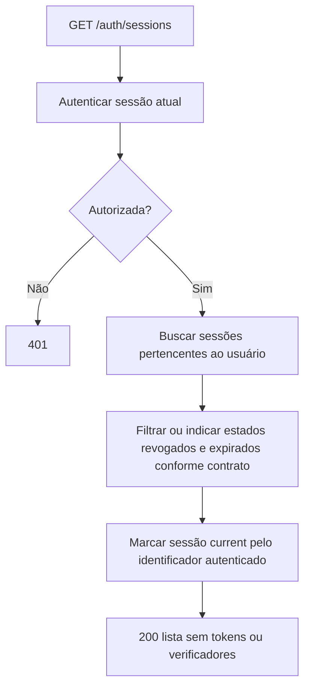

### 6.8 `DELETE /auth/sessions/{id}`

**Objetivo:** revogar outra sessão própria por seu identificador. A operação deve validar a **titularidade**; um ID de outro usuário não concede acesso.

**Sucesso:** `204 No Content`; para ID inexistente ou que não pertence ao usuário, usar resposta que não exponha informações de terceiros (como `404`).

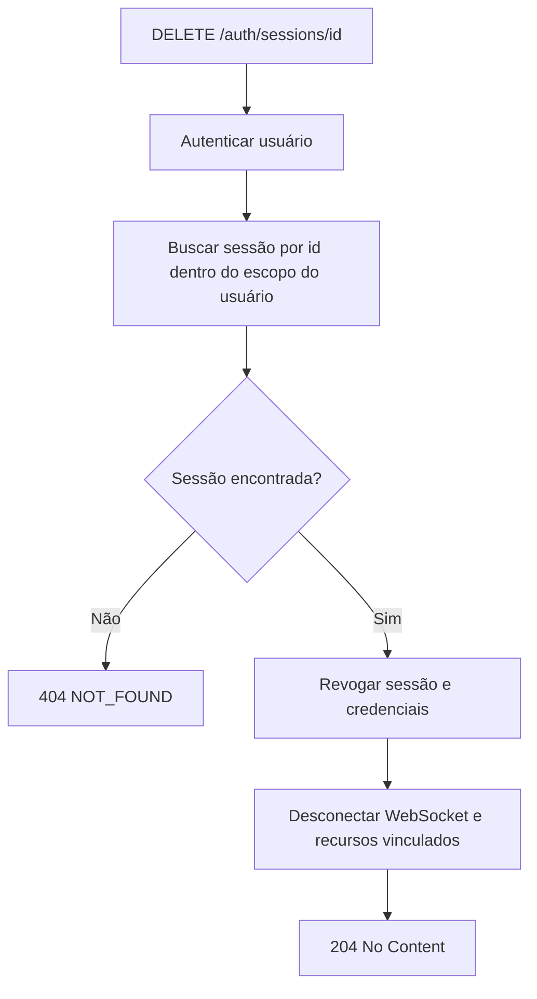

Se a sessão alvo for a atual, o cliente deverá perder sua própria autenticação. **[PENDENTE]** Definir se a interface permite revogar a atual por essa rota ou orienta o usuário para `/auth/logout`.

### 6.9 `POST /auth/logout-all`

**Objetivo:** invalidar **todas as sessões do próprio usuário** naquela instância, inclusive a atual, e forçar reautenticação nos dispositivos.

**Sucesso:** `204 No Content`.

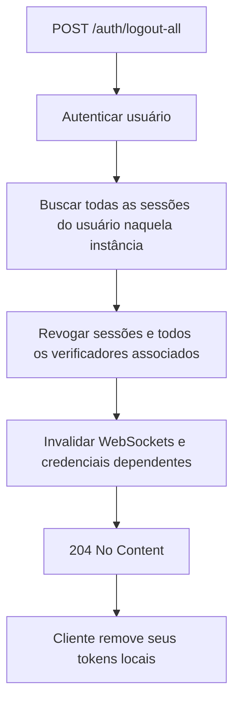

**Nenhuma dessas rotas é de administração de sessões de terceiros.** A capacidade de um MASTER/ADMIN encerrar sessões alheias, se necessária, terá autorização e contrato próprios no módulo de administração.

---
## 7. Configurações da instância

### 7.1 Finalidade

As configurações da instância controlam comportamentos globais, sobretudo **como novas pessoas ingressam**. São dados persistidos no servidor; não devem depender de variáveis de ambiente depois que o bootstrap termina. Apenas o **MASTER** pode visualizá-las integralmente e alterá-las pela API administrativa da V1.

### 7.2 Configurações incluídas

| Campo | Tipo conceitual | Descrição | Estado |
|---|---|---|---|
| `name` | string | Nome público exibido durante descoberta e na UI | **[DEFINIDO]** |
| `description` | string opcional | Breve apresentação pública | **[DEFINIDO]** |
| `icon` | string/asset opcional | Identidade visual apresentada ao cliente | **[DEFINIDO]** |
| `joinPolicy` | enum | Regra para cadastro de novos usuários | **[DEFINIDO]** |

`name`, `description` e `icon` são metadados de apresentação. `joinPolicy` é uma **regra de negócio obrigatória**, consultada no momento do cadastro. Recomenda-se validação de tamanhos, sanitização e segurança da origem de assets. **[PENDENTE]** Especificar se `icon` será URL, identificador de asset ou payload gerenciado; não aceitar URLs arbitrárias sem validação.

### 7.3 Políticas de ingresso

| Política | Novo cadastro público | Efeito sobre usuários `ACTIVE` existentes |
|---|---|---|
| `PUBLIC` | Cria `MEMBER ACTIVE` | Mantêm acesso normal |
| `APPROVAL_REQUIRED` | Cria `MEMBER PENDING`; não autentica até aprovação | Mantêm acesso normal |
| `CLOSED` | Bloqueia novos cadastros públicos | Mantêm acesso normal |

**[DEFINIDO]** A mudança da política tem efeito em novas tentativas de cadastro; não reverte automaticamente o estado de usuários antigos, não desconecta membros ativos nem apaga solicitações pendentes.

**[PENDENTE]** O módulo de administração/ingresso definirá endpoints para listar solicitações, aprovar, recusar e, se necessário, convites. A intenção definida é permitir aprovação por **MASTER e ADMIN**, com autorização específica. Essas rotas **não são parte do contrato de configurações atual**.

### 7.4 Modelo e atualização

Uma entidade ou registro `InstanceSettings` possui as quatro propriedades V1, um vínculo com a instância e opcionalmente `version`, `updatedAt` e `updatedBy`, para concorrência/auditoria. As três últimas são **[REFERÊNCIA V1]** e não precisam ser expostas em `/instance/info`.

A atualização usa `PATCH`: omitir um campo significa **preservar** o valor atual. Campos administrativos desconhecidos devem ser rejeitados, e a operação não pode alterar `ownerUserId`, `status`, tokens ou usuários por meio de *mass assignment*.

### 7.5 `GET /instance/info` — descoberta pública

**Objetivo:** fornecer dados públicos necessários para o cliente reconhecer a instância **antes do login**. É o contrato comum entre o módulo de configurações e o bootstrap do desktop.

**Acesso:** público, apenas enquanto a instância está pronta para servir. O endpoint **não revela configurações internas nem credenciais**.

**Resposta de referência do endpoint:**

```json
{
  "instance": {
    "id": "inst_01",
    "name": "Comunidade Groups Chat",
    "description": "Servidor da comunidade",
    "icon": null,
    "status": "READY",
    "joinPolicy": "APPROVAL_REQUIRED"
  },
  "protocol": {
    "version": "1.0",
    "minClientVersion": "1.0.0"
  },
  "endpoints": {
    "api": "https://api.comunidade.example",
    "realtime": "wss://api.comunidade.example/realtime"
  },
  "features": {
    "textChat": true,
    "voiceChat": true,
    "screenShare": true
  }
}
```

**Observações:** os campos `protocol`, `endpoints` e `features` foram incluídos na especificação de **descoberta do Tauri** e devem ser preservados na versão unificada da API. Nome, descrição, ícone e política vêm das configurações persistidas; `status`, protocolo e endereços dependem do serviço e do deployment. Os valores exemplificados de protocolo/URLs não são configurações globais da V1 que o MASTER necessariamente edita.

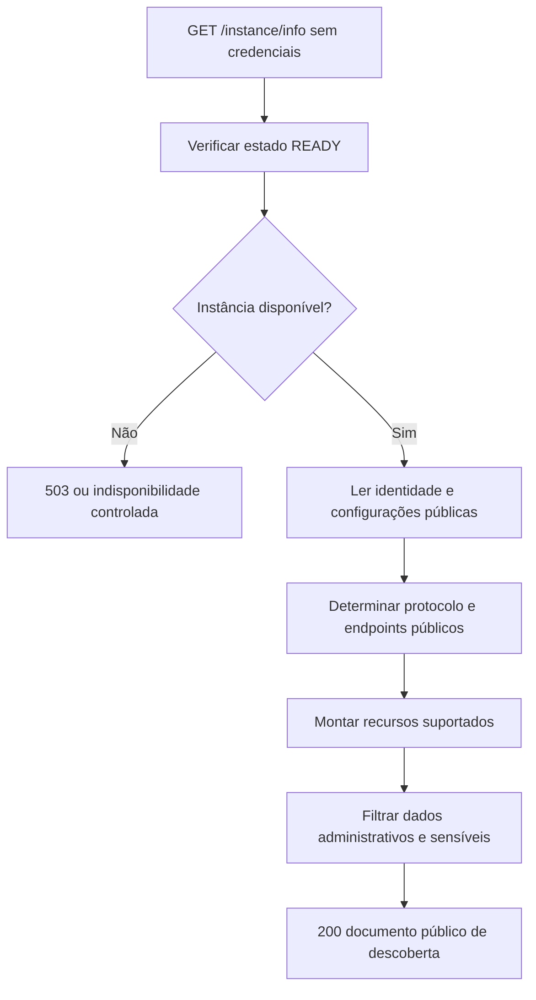

### 7.6 `GET /instance/settings` — leitura administrativa

**Acesso:** exclusivamente MASTER autenticado.

**Resposta de referência:**

```json
{
  "name": "Comunidade Groups Chat",
  "description": "Servidor da comunidade",
  "icon": null,
  "joinPolicy": "APPROVAL_REQUIRED",
  "version": 4,
  "updatedAt": "2026-11-17T14:00:00Z"
}
```

Os campos `version` e `updatedAt` são úteis à gestão, mas **a forma exata é [REFERÊNCIA V1]**.

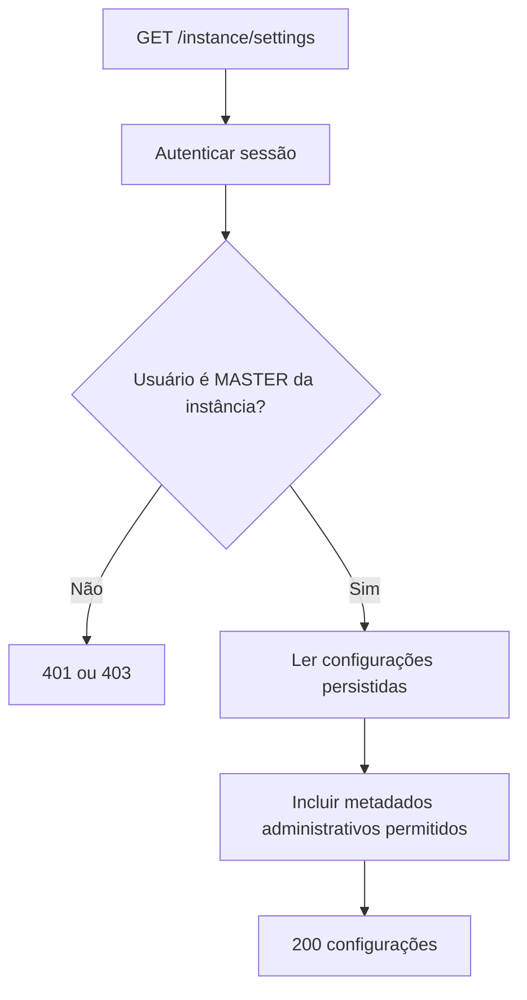

### 7.7 `PATCH /instance/settings` — atualização administrativa

**Acesso:** exclusivamente MASTER autenticado. Atualização parcial e persistida, sem necessidade de reinício.

**Entrada ilustrativa:**

```json
{
  "name": "Comunidade de Desenvolvimento",
  "description": "Conversas e projetos",
  "joinPolicy": "PUBLIC"
}
```

**Resposta:** `200 OK` com o estado atualizado (ou `204` se padronizado nesse estilo). Recomenda-se `200` com representação, para refletir mudanças imediatamente na interface.

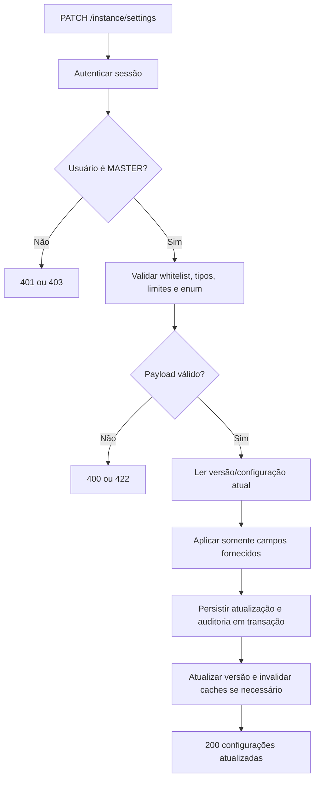

**Concorrência [REFERÊNCIA V1]:** usar versão/controle otimista para impedir que duas edições do MASTER silenciosamente substituam a alteração mais recente. Falha de versão pode retornar `409 Conflict`. A estratégia exata será fechada na etapa de contrato/implementação.

### 7.8 Outras configurações consideradas, mas não incluídas agora

Foram sugeridas `maxMembers`, `allowMemberCreateWorkspaces`, `maxMessageLength` e `allowScreenSharing`. **Não fazem parte do subconjunto de quatro configurações fixado para a V1 inicial.** Devem ser discutidas quando os módulos de membros, workspaces, mensagens e chamadas necessitarem delas, evitando uma API global inflada antes de haver regras concretas.

---

## 8. Bootstrap do cliente desktop Tauri

### 8.1 Objetivos

O desktop deve abrir mesmo que nenhuma instância esteja disponível. O usuário pode cadastrar uma nova instância, descobrir seus metadados, entrar com credenciais específicas dela e ter sessões persistentes. Ao reiniciar o aplicativo, o cliente tenta restaurar as conexões conhecidas de forma independente.

### 8.2 Componentes internos

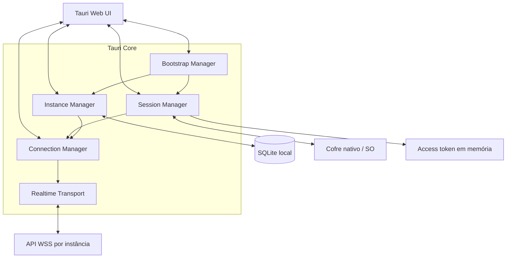

**Bootstrap Manager:** inicia dependências locais, carrega instâncias salvas, coordena restauração e entrega estados à UI.

**Instance Manager:** adiciona, verifica, atualiza e remove cadastros locais de instâncias; trata mudanças de URL ou identidade remota.

**Session Manager:** login, refresh centralizado, logout, restauração e isolamento de credenciais por instância.

**Connection Manager:** estabelece WebSocket, acompanha heartbeat, estados online/offline e realiza reconexão por instância.

**Realtime Transport:** protocolo de eventos da aplicação. É separado da conexão de mídia do LiveKit.

### 8.3 Armazenamento local

| Dado | Local | Justificativa |
|---|---|---|
| `localId` da instância | SQLite | Identificador estável do cadastro no cliente |
| `remoteInstanceId` | SQLite | Identificador público do servidor descoberto |
| URL de entrada e endpoints públicos | SQLite | Reconexão e redescoberta |
| Nome, ícone, descrição, recursos, versão | SQLite/cache | Renderização mesmo sem rede |
| Último usuário conectado e metadados não sensíveis | SQLite | Experiência de uso |
| Histórico/cache offline (futuro) | SQLite | Experiência local, conforme módulo de mensagens |
| Refresh token por sessão/instância | Cofre seguro do SO | Persistência de segredo entre reinícios |
| Access token | Memória do processo | Minimizar permanência e exposição |
| Senha | Não persistir | Usada apenas durante login/cadastro |

**[REFERÊNCIA V1]** Criar uma chave de cofre baseada em `(localId, accountId/sessionId)` ou equivalente, para não sobrepor tokens de instâncias distintas. A associação à instância remota precisa ser validada antes de usar um refresh token recuperado.

### 8.4 Distinção `localId` × `remoteInstanceId`

- `localId`: ID gerado pelo cliente para o registro local de conexão, mesmo antes de o servidor responder.
- `remoteInstanceId`: ID fornecido em `/instance/info` e associado permanentemente à instância no servidor.
- `baseUrl`: endereço usado para descobrir aquela instância. Pode mudar por migração ou troca de domínio.

Essa separação permite identificar tanto **URLs duplicadas apontando para a mesma instância** quanto a situação mais grave de **um endereço anteriormente conhecido passar a responder como outra instância**. O cliente não deve enviar o refresh token anterior a uma identidade remota inesperada.

### 8.5 Estados de conectividade

| Estado | Significado |
|---|---|
| `DISCOVERING` | Consultando `/instance/info` e verificando compatibilidade |
| `ONLINE` | Servidor acessível; canal autenticado ainda não estabelecido |
| `CONNECTING` | Iniciando conexão autenticada em tempo real |
| `CONNECTED` | WebSocket pronto e confirmação `connection.ready` recebida |
| `RECONNECTING` | Conexão caiu e há nova tentativa em andamento |
| `OFFLINE` | Servidor não pôde ser alcançado; cache pode continuar visível |
| `INCOMPATIBLE` | Protocolo/versão/endpoints incompatíveis ou identidade divergente |

Estados de autenticação, mantidos em dimensão **separada**:

| Estado | Significado |
|---|---|
| `UNAUTHENTICATED` | Sem sessão local |
| `RESTORING` | Tentando renovar sessão guardada |
| `AUTHENTICATED` | Usuário e sessão válidos |
| `AUTH_REQUIRED` | Credenciais ausentes, expiradas ou revogadas |
| `PENDING_APPROVAL` | Conta existe, mas aguarda ativação |
| `ACCESS_DENIED` | Conta bloqueada ou autorização negada |

**Regra de modelagem:** a instância pode estar `ONLINE` e `UNAUTHENTICATED`; pode estar `OFFLINE` e ter uma sessão potencialmente restaurável no cofre. Conectividade não implica autenticação.

### 8.6 Inicialização do aplicativo

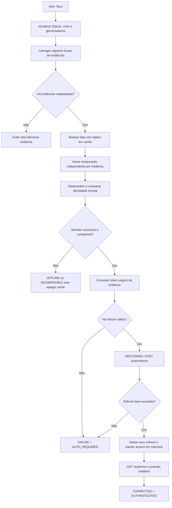

A seta de `GET /auth/me` representa uma validação/recuperação de perfil que pode ocorrer antes ou depois da abertura do canal, desde que o modelo de estado continue coerente. **Falhas de rede não são automaticamente sessões inválidas**: diferenciar timeout/offline de `401/403`.

### 8.7 Adicionar uma instância

**Entrada:** URL informada pelo usuário. Nenhum `username`, senha ou token deve ser enviado nessa etapa.

**Procedimento:**

1. Analisar URL, esquema, host e porta; normalizar sem mudar origem indevidamente.
2. Verificar política de transporte: HTTPS em produção; exceções locais explícitas e restritas, se houver.
3. Executar `GET {baseUrl}/instance/info` com timeout e limites de tamanho.
4. Validar resposta, `instance.id`, estado `READY`, esquema de protocolo e compatibilidade de versões.
5. Validar os endpoints sugeridos pelo servidor antes de segui-los, inclusive HTTPS/WSS, origens, redirects e endereços inesperados.
6. Verificar se o `remoteInstanceId` já está salvo ou se o endereço conhecido agora representa outro servidor.
7. Persistir o cadastro e mostrar nome/descrição/política de ingresso.
8. Permitir login, cadastro quando a política permitir, ou apenas visualização de estado quando fechado/incompatível.

```mermaid
flowchart TD
    A[Usuário informa URL] --> B[Normalizar e validar URL]
    B --> C{Origem permitida e esquema seguro?}
    C -- Não --> X[Erro de URL/segurança]
    C -- Sim --> D[GET /instance/info sem tokens]
    D --> E{Resposta recebida e formato válido?}
    E -- Não --> Y[Erro de descoberta / OFFLINE]
    E -- Sim --> F{READY e versões compatíveis?}
    F -- Não --> Z[INCOMPATIBLE ou indisponível]
    F -- Sim --> G[Validar endpoints, redirecionamentos e origem]
    G --> H{remoteInstanceId já conhecido?}
    H -- Sim --> I[Evitar duplicação ou solicitar decisão sobre migração]
    H -- Não --> J[Salvar localId + remoteInstanceId + endpoints]
    I --> K[Mostrar identidade da instância]
    J --> K
    K --> L[Exibir opções login/cadastro conforme joinPolicy]
```

### 8.8 Validação de descoberta e proteção de credenciais

A API de descoberta não é uma autoridade irrestrita para redirecionar o cliente a qualquer endereço. Resposta e URL são dados **não confiáveis** até validação.

- Verificar TLS/certificados em produção.
- Evitar redirecionamentos automáticos que migrem credenciais para outro host.
- Validar cuidadosamente hosts privados, loopback e link-local; como o produto é self-hosted, **acesso LAN pode ser intencional**, mas precisa de uma política explícita, e não de bloqueio genérico.
- Comparar a identidade remota armazenada antes de restaurar tokens.
- Confirmar versões mínimas e capacidades antes de oferecer recursos não suportados.
- Restringir tamanho, estrutura e campos consumidos de `/instance/info`.
- **Não** enviar refresh/access token ao endpoint de descoberta, a um domínio não verificado ou a uma URL resultante de redirect suspeito.

### 8.9 Login e cadastro pelo desktop

```mermaid
flowchart TD
    A[Usuário seleciona instância] --> B{Ação?}
    B -- Login --> C[POST /auth/login com username/password]
    B -- Cadastro --> D{joinPolicy disponível?}
    D -- CLOSED --> E[Cadastro indisponível]
    D -- PUBLIC ou APPROVAL_REQUIRED --> F[POST /auth/register]
    F --> G{Resultado?}
    G -- ACTIVE --> H[Conta criada; oferecer login]
    G -- PENDING --> I[Exibir PENDING_APPROVAL]
    C --> J{Autenticou?}
    J -- Não --> K[Exibir erro coerente com código]
    J -- Sim --> L[Salvar refresh token no cofre]
    L --> M[Manter access em memória e perfil local]
    M --> N[Conectar /realtime]
```

O cadastro não recebe tokens automaticamente na especificação do módulo de identidade. Se o usuário já criou conta `ACTIVE`, faz login em operação separada. O cliente nunca tenta autenticar um `PENDING` como se estivesse aprovado.

### 8.10 Troca de instância ativa

A instância **em foco na UI** é diferente da lista de instâncias **conectadas**. Alternar de A para B não deve, por padrão, efetuar logout ou desconectar A. Cada contexto mantém estado próprio de sessão, WS, dados e reconexão. Regras de economia de recursos para suspender conexões de instâncias inativas podem ser avaliadas posteriormente, mas não devem causar mistura de credenciais.

### 8.11 Remoção de instância no cliente

**[REFERÊNCIA V1]** Ao remover um cadastro local, o cliente deve eliminar metadados/cache e o segredo no cofre daquela instância. Se online e autenticado, pode oferecer logout remoto antes da remoção. **Remover uma instância localmente não equivale a apagar a instância no servidor**, nem a excluir o usuário. Se a revogação remota falhar, o cliente não pode afirmar que todas as sessões no servidor foram encerradas.

---
## 9. API de conexão em tempo real

### 9.1 `GET /realtime` — WebSocket autenticado

**[REFERÊNCIA V1]** O servidor expõe a rota de upgrade WebSocket `GET /realtime` por WSS através do gateway. Essa rota pertence ao Application Server e transporta **eventos da aplicação**, não áudio/vídeo do LiveKit.

**Estabelecimento:**

1. Cliente já descobriu e verificou a identidade da instância.
2. Existe sessão autenticada e access token válido naquela instância.
3. Cliente solicita upgrade WebSocket em `/realtime`, enviando `Authorization: Bearer <accessToken>` se a biblioteca de transporte permitir.
4. Servidor autentica token, sessão e usuário **antes de aceitar o upgrade**.
5. Após sucesso, envia `connection.ready` com identidade da conexão.
6. Cliente muda `CONNECTING` para `CONNECTED`, inicia heartbeat e pode subscrever eventos autorizados conforme futuros módulos.

**Exemplo de evento inicial:**

```json
{
  "type": "connection.ready",
  "data": {
    "connectionId": "conn_01",
    "instanceId": "inst_01",
    "userId": "usr_01",
    "serverTime": "2026-11-17T14:00:00Z"
  }
}
```

**Atenção ao transporte Tauri:** o construtor `WebSocket` padrão de uma WebView/navegador **não permite definir livremente o cabeçalho `Authorization`**. A especificação acima pressupõe um cliente WebSocket nativo controlado pelo Tauri Core ou uma alternativa de autenticação. Se a implementação utilizar o WebSocket da WebView, será preciso definir **[PENDENTE]** um *connection ticket* efêmero emitido pela API ou mecanismo seguro equivalente. **Não passar refresh token nem access token duradouro pela query string** como atalho.

**Fluxo de upgrade:**

```mermaid
sequenceDiagram
    participant C as Cliente Tauri
    participant G as Gateway
    participant A as Application Server
    participant S as Session Store
    C->>G: GET /realtime + Upgrade + Bearer
    G->>A: Encaminhar upgrade
    A->>S: Validar access, sessão e usuário
    alt Token, sessão ou usuário inválido
        S-->>A: Inválido
        A-->>G: Negar upgrade (401/403)
        G-->>C: Erro de autenticação
    else Autorizado
        S-->>A: Autorizado
        A-->>C: 101 Switching Protocols
        A-->>C: connection.ready
        loop Enquanto a conexão estiver ativa
            C-->>A: Ping / atividade
            A-->>C: Pong / eventos autorizados
        end
    end
```

A validação inicial não dispensa tratamento posterior de expiração/revogação da sessão. O método de renovação de credencial com WS aberto deve ser **definido de forma consistente**: revalidar periodicamente a sessão, solicitar reconexão autenticada após refresh ou adotar solução equivalente. A V1 não pode manter uma conexão indefinidamente após revogação.

### 9.2 Conexões isoladas por instância

```mermaid
flowchart TB
    T[Tauri Core]
    T --> SA[Session A]
    T --> SB[Session B]
    T --> SC[Session C]
    SA --> WA[WebSocket A]
    SB --> WB[WebSocket B]
    SC --> WC[WebSocket C]
    WA --> A[API A]
    WB --> B[API B]
    WC --> C[API C]
```

Cada instância tem conexão, token, ciclo de refresh, erros e reconexão próprios. `ONLINE/CONNECTED` em A não informa o estado de B. Trocar a instância selecionada na UI não altera a titularidade dessas conexões.

### 9.3 Heartbeat, detecção de queda e reconexão

**[REFERÊNCIA V1]** Usar heartbeat Ping/Pong, timeouts e reconexão com *exponential backoff* e *jitter*, com intervalo ilustrativo entre **1 e 60 segundos**. Não utilizar um loop agressivo de tentativas a cada poucos milissegundos.

```mermaid
stateDiagram-v2
    [*] --> DISCOVERING
    DISCOVERING --> ONLINE: info válida
    DISCOVERING --> OFFLINE: timeout/indisponível
    DISCOVERING --> INCOMPATIBLE: versão ou identidade divergente
    ONLINE --> CONNECTING: sessão autenticada
    CONNECTING --> CONNECTED: connection.ready
    CONNECTING --> RECONNECTING: queda temporária
    CONNECTED --> RECONNECTING: heartbeat falha / socket fecha
    RECONNECTING --> CONNECTED: reconectou e recebeu ready
    RECONNECTING --> OFFLINE: servidor indisponível
    OFFLINE --> DISCOVERING: nova tentativa
    INCOMPATIBLE --> DISCOVERING: usuário corrige URL/atualiza app
```

**Comportamento de reconexão:**

```mermaid
flowchart TD
    A[WebSocket fechou ou heartbeat expirou] --> B[Marcar instância RECONNECTING]
    B --> C{Sessão local ainda disponível?}
    C -- Não --> X[AUTH_REQUIRED; parar tentativa autenticada]
    C -- Sim --> D[Programar tentativa com backoff e jitter]
    D --> E{Access token expirado?}
    E -- Sim --> F[Refresh single-flight]
    E -- Não --> G[Tentar novo upgrade /realtime]
    F --> H{Refresh válido?}
    H -- Não, sessão revogada --> X
    H -- Falha transitória --> D
    H -- Sim --> G
    G --> I{Upgrade + connection.ready?}
    I -- Sim --> J[CONNECTED e zerar backoff]
    I -- Não, rede --> D
    I -- Não, incompatível --> K[INCOMPATIBLE]
    I -- Não, sessão inválida --> X
```

**Distinções indispensáveis:**

- `401` de sessão expirada/revogada → `AUTH_REQUIRED` após tentativa apropriada de refresh, não uma reconexão infinita.
- Falha de DNS, timeout ou conexão recusada → `OFFLINE/RECONNECTING`, sem apagar refresh token por impulso.
- Incompatibilidade de protocolo → `INCOMPATIBLE`, sem enviar indefinidamente a mesma requisição.
- `429` → respeitar `Retry-After` quando houver.
- Evento `connection.ready` confirma o canal de aplicação, **não uma conexão LiveKit**.

### 9.4 Eventos futuros e entrega confiável

**[PENDENTE]** O protocolo de mensagens/gerenciamento de canais definirá assinatura por sala, autorização de eventos, IDs de evento, confirmação de entrega, deduplicação, sincronização de mensagens perdidas durante reconexão e limites de payload. O bootstrap de conectividade não precisa decidir esses protocolos agora, mas deve deixar um ponto de extensão no `Realtime Transport`.

Uma conexão WebSocket bem-sucedida, por si só, **não garante entrega exatamente uma vez** de mensagens de domínio. Persistência, idempotência e recuperação de histórico devem ser resolvidas no módulo de mensagens.

---

## 10. Contratos e integrações entre módulos

### 10.1 Catálogo total de rotas-base

| Domínio | Método | Rota | Acesso | Status |
|---|---|---|---|---|
| Descoberta | `GET` | `/instance/info` | Público | **[DEFINIDO]** |
| Configurações | `GET` | `/instance/settings` | MASTER | **[DEFINIDO]** |
| Configurações | `PATCH` | `/instance/settings` | MASTER | **[DEFINIDO]** |
| Identidade | `POST` | `/auth/register` | Público, condicionado à política | **[DEFINIDO]** |
| Identidade | `POST` | `/auth/login` | Público | **[DEFINIDO]** |
| Sessões | `POST` | `/auth/refresh` | Refresh token | **[DEFINIDO]** |
| Sessões | `POST` | `/auth/logout` | Sessão atual | **[DEFINIDO]** |
| Identidade | `GET` | `/auth/me` | Autenticado | **[DEFINIDO]** |
| Sessões | `GET` | `/auth/sessions` | Autenticado | **[DEFINIDO]** |
| Sessões | `DELETE` | `/auth/sessions/{id}` | Proprietário da sessão | **[DEFINIDO]** |
| Sessões | `POST` | `/auth/logout-all` | Autenticado | **[DEFINIDO]** |
| Conectividade | `GET` | `/realtime` | Upgrade WebSocket autenticado | **[REFERÊNCIA V1]** |

Total: **12 rotas-base** de aplicação/descoberta/conectividade, sendo 8 de autenticação, 3 de instância e 1 de WebSocket. Rotas de `health`, métricas, API do LiveKit e funcionalidades de futuros módulos podem existir na implantação, mas **não foram adicionadas aqui como contratos de domínio aprovados**.

### 10.2 Fluxo de primeiro uso completo

```mermaid
sequenceDiagram
    participant O as Operador da instância
    participant A as Application Server
    participant DB as Persistência
    participant T as Tauri
    participant V as Cofre do SO
    O->>A: Iniciar com BOOTSTRAP_* no ambiente
    A->>DB: Verificar UNINITIALIZED
    A->>DB: Transação: instância + MASTER + READY
    A-->>O: Serviço pronto
    T->>A: GET /instance/info
    A-->>T: Identidade, joinPolicy, protocolo e endpoints
    T->>T: Salvar localId e remoteInstanceId
    Note over T,A: Usuário usa uma conta existente ou se cadastra conforme política
    T->>A: POST /auth/login
    A->>DB: Verificar usuário/senha, criar sessão
    A-->>T: Access + Refresh + perfil
    T->>V: Persistir refresh da instância
    T->>A: GET /auth/me
    A-->>T: Perfil atual
    T->>A: GET /realtime (upgrade autenticado)
    A-->>T: connection.ready
```

### 10.3 Matriz de dependências funcionais

| Módulo futuro | O que recebe desta base | O que deve definir por conta própria |
|---|---|---|
| Aprovação/ingresso | `joinPolicy`, conta `PENDING`, MASTER/ADMIN | Listar, aprovar, recusar solicitações; convites se desejados |
| Administração de membros | Usuários, papéis, estados, owner | Promoção ADMIN, bloqueio, políticas de moderação |
| Workspaces/canais | Contexto de usuário, sessão, RBAC básico | Criação, propriedades, membership e autorização por workspace/canal |
| Mensagens | WebSocket da aplicação, PostgreSQL, usuário autenticado | Histórico, operações, entrega, leitura, reenvio e eventos |
| Presença | WS e identidade da sessão | Status por usuário/dispositivo, TTL, múltiplas conexões |
| Voz/tela | Auth, autorização por recurso, LiveKit | Salas, permissões, token LiveKit, eventos, UX e limites |
| Notificações | Sessão, estado e canais conectados | Eventos notificáveis, fan-out e entrega offline |
| Observabilidade | Identificadores de instância/conexão/sessão | Métricas, tracing, logs sem segredos, alertas |

### 10.4 Conexão com o LiveKit

```mermaid
sequenceDiagram
    participant C as Cliente
    participant A as Application Server
    participant D as Autorização / Dados
    participant L as LiveKit
    C->>A: Solicitar participação em sala (rota futura)
    A->>D: Validar sessão, papel e permissão da sala
    alt Não autorizado
        A-->>C: 403 ACCESS_DENIED
    else Autorizado
        A->>A: Gerar token LiveKit de curta duração e escopo limitado
        A-->>C: Token e endpoint de mídia
        C->>L: Conexão LiveKit / ICE / WebRTC
        L-->>C: Fluxo de áudio / vídeo / tela
        L->>A: Webhooks assinados de eventos
        A->>A: Validar assinatura, deduplicar e conciliar estado
    end
```

**A rota para emissão de tokens LiveKit e o modelo de permissões das salas ainda serão especificados no módulo de voz e compartilhamento de tela.** O diagrama estabelece o contrato de integração esperado, sem determinar antecipadamente o caminho HTTP.

### 10.5 Ordenação de dependências na implementação

```mermaid
flowchart TD
    A[Persistência e migrações] --> B[Bootstrap API MASTER + READY]
    B --> C[Usuários e sessões]
    B --> D[Configurações /instance]
    C --> E[Descoberta e bootstrap Tauri]
    D --> E
    E --> F[Conectividade /realtime]
    F --> G[Eventos, mensagens e presença]
    C --> H[Autorização de recursos]
    H --> G
    H --> I[Tokens e integração LiveKit]
    I --> J[Voz, mídia e tela]
```

---

## 11. Padrão de respostas, erros e versionamento

### 11.1 Erros HTTP

**[REFERÊNCIA V1]** Padronizar erros seguindo *Problem Details* (RFC 9457), com `Content-Type: application/problem+json`. Exemplo:

```json
{
  "type": "about:blank",
  "title": "Authentication failed",
  "status": 401,
  "code": "INVALID_CREDENTIALS",
  "detail": "Invalid username or password"
}
```

| Código de aplicação | Situação típica | HTTP de referência |
|---|---|---|
| `INVALID_CREDENTIALS` | Username/senha incorretos | `401` |
| `ACCOUNT_PENDING_APPROVAL` | Usuário aguarda aprovação | `403` |
| `ACCOUNT_DISABLED` | Conta bloqueada | `403` |
| `SESSION_EXPIRED` | Sessão/token expirado | `401` |
| `SESSION_REVOKED` | Sessão encerrada ou refresh reutilizado | `401` |
| `REGISTRATION_CLOSED` | Política impede cadastro | `403` |
| `RATE_LIMITED` | Limite de tentativas atingido | `429` |
| `FORBIDDEN` | Sem papel ou permissão para ação | `403` |
| `NOT_FOUND` | Recurso próprio não encontrado | `404` |
| `CONFLICT` | Username ocupado/conflito de versão | `409` |
| `VALIDATION_ERROR` | Payload inválido | `400` ou `422` |
| `INCOMPATIBLE_PROTOCOL` | Cliente/servidor não compatível | Código/HTTP **[PENDENTE]** |

A mensagem pública de erro não deve expor consultas internas, hash, segredos ou detalhes que facilitem enumeração. IDs de correlação para suporte/observabilidade são recomendáveis.

### 11.2 Versionamento de contrato

O documento de descoberta inclui:

- `protocol.version`: versão do protocolo suportado pela instância;
- `protocol.minClientVersion`: versão mínima do aplicativo cliente;
- `features`: recursos disponíveis para a UI;
- `endpoints`: endereços públicos efetivamente utilizáveis pelo cliente.

**[PENDENTE]** Definir o esquema formal de compatibilidade (*major/minor*, intervalos de versões, capacidades opcionais) e quando mudar versão de protocolo ou de API. O cliente precisa rejeitar incompatibilidades reais, não somente comparar strings de versões lexicalmente.

### 11.3 Consistência dos DTOs

Ao implementar, padronizar de uma só vez:

- `camelCase` versus `snake_case` nos corpos JSON;
- Representação de timestamps (recomenda-se ISO 8601 em UTC);
- Formato dos IDs (UUID/UUIDv7 ou outro identificador opaco);
- Envelope de dados de sessão (`session.accessToken`, `session.refreshToken`) e perfil;
- Representação de `PENDING`, erro e códigos HTTP da rota de cadastro;
- Códigos estáveis de erro para a UI;
- Forma de autenticação do handshake do WebSocket;
- Política de `ETag`/versão para alterações administrativas.

**Os exemplos JSON deste documento representam contratos de referência, não um schema OpenAPI final.** A semântica e as rotas compõem a arquitetura-base; a padronização de DTOs e convenções HTTP deve ocorrer antes da implementação.

---

## 12. Segurança e operação

### 12.1 Checklist de segurança transversal

- [ ] Bootstrap só cria MASTER uma vez; tentativa concorrente não cria duplicatas.
- [ ] Variáveis `BOOTSTRAP_*` não mudam senha/configuração após `READY`.
- [ ] Senhas possuem hash adaptativo, salt e política de atualização de parâmetros.
- [ ] `usernameCanonical` é único na instância e checado transacionalmente.
- [ ] Access/refresh tokens são opacos, imprevisíveis e não ficam nos logs.
- [ ] Refresh é rotativo, uso único e protegido contra corrida/replay.
- [ ] Sessões revogadas não permitem novos HTTP/WS autorizados.
- [ ] Remoção/bloqueio de usuário invalida suas capacidades em tempo real.
- [ ] MASTER é único e endpoints de configuração verificam titularidade real.
- [ ] Cadastro nunca permite definir role pelo payload.
- [ ] Rate limiting protege autenticação e criação de usuários.
- [ ] Cliente guarda refresh apenas no cofre nativo, access apenas em memória.
- [ ] Discovery não recebe credenciais e não pode redirecioná-las a outro host.
- [ ] HTTPS/WSS, validação de certificado e proteção contra endpoints falsos.
- [ ] LiveKit emite tokens de mídia com permissões mínimas e prazo curto.
- [ ] Webhooks LiveKit validam autenticidade e idempotência.
- [ ] Backups, retenção, logs e migrações não expõem segredos.

### 12.2 Política de transporte e deployment

O reverse proxy roteia API e upgrade WS. A infraestrutura de LiveKit exige planejamento adicional de portas e alcance de ICE/TURN; a conectividade de áudio e vídeo não estará garantida apenas por expor `443` para a API da aplicação. Em ambientes LAN e de laboratório podem existir exceções de transporte, **mas elas precisam ser declaradas como configurações de desenvolvimento, não aceitas silenciosamente em produção**.

### 12.3 Disponibilidade e degradação

- API fora do ar: cliente mantém lista e metadados previamente armazenados, exibindo `OFFLINE`.
- LiveKit fora do ar: chat textual pode permanecer disponível se Application Server/DB estiverem saudáveis.
- Redis indisponível (quando usado): definir fallback/cache conforme os recursos efetivamente implementados; não tratá-lo como verdade persistente.
- PostgreSQL indisponível: não autorizar operações cujo estado não possa ser verificado de forma segura.
- Perda de conectividade do Tauri: exibir estado offline, reconectar gradualmente e não descartar sessão válida sem evidência.

### 12.4 Concorrência e integridade

Pontos que exigem garantias transacionais ou equivalentes: criar MASTER; impor username único; emitir sessão inicial; rotacionar refresh; revogar várias sessões; persistir alterações de configuração; posteriormente, receber mensagens/webhooks idempotentes. Revisões de autorização devem considerar race conditions (por exemplo, conta bloqueada durante o upgrade WS).

---

## 13. Critérios de aceitação da arquitetura-base

### 13.1 Bootstrap do servidor

1. Primeira inicialização com variáveis válidas cria uma instância `READY`, configurações padrão e exatamente um MASTER.
2. Variáveis ausentes/inválidas impedem o primeiro bootstrap sem salvar estado parcial.
3. Segundo boot, mesmo com variáveis alteradas, preserva MASTER, senha e configurações persistidas.
4. Duas réplicas inicializadas juntas não criam dois MASTERs.
5. Não existem endpoints públicos de `/setup` que concedam controle administrativo.

### 13.2 Identidade e sessões

1. `marina` e `Marina` conflitam no cadastro da mesma instância; podem existir em instâncias distintas.
2. Cadastro `PUBLIC` gera `MEMBER ACTIVE`, sem sessão implícita.
3. Cadastro `APPROVAL_REQUIRED` gera `MEMBER PENDING`, sem acesso autenticado.
4. Cadastro `CLOSED` é recusado sem alterar usuários existentes.
5. Login incorreto não revela se o username existe; tentativas excessivas são limitadas.
6. Login válido gera sessão persistente e access/refresh tokens próprios.
7. Refresh rotaciona tokens; duas chamadas simultâneas não consomem o mesmo refresh com sucesso.
8. Reutilização de refresh revoga sessão afetada.
9. Logout atual e remoto impedem reutilização de credenciais e conexões daquela sessão.
10. `logout-all` encerra todas as sessões do usuário, mas não sessões de outras contas.
11. Um MEMBER não consegue fazer `PATCH /instance/settings`.

### 13.3 Descoberta e cliente Tauri

1. Cliente sem instância abre tela de inclusão, sem depender de conexão a um serviço central.
2. Adição consulta `/instance/info` sem enviar credenciais.
3. Instâncias incompatíveis ou com endpoints inválidos não recebem tokens de sessões antigas.
4. Mesmo hostname com `remoteInstanceId` diferente exige cautela e não restaura refresh automaticamente.
5. Cliente restaura tokens por instância e mantém refresh fora do SQLite.
6. Duas instâncias autenticadas conservam acessos separados mesmo ao mudar aba selecionada.
7. Queda da instância A não interrompe a conexão B.
8. WS só é marcado como `CONNECTED` depois de `connection.ready`.
9. Revogação causa `AUTH_REQUIRED` e desconexão; falha transitória usa `RECONNECTING/OFFLINE` sem limpar segredo indevidamente.
10. Reconexões usam backoff com jitter; nenhum loop consome recursos sem limite.

### 13.4 Configurações

1. MASTER consegue consultar e alterar as quatro configurações V1 sem reiniciar a API.
2. ADMIN/MEMBER não obtêm acesso às rotas administrativas de settings.
3. GET `/instance/info` mostra atualização pública sem expor informações sensíveis.
4. Mudança de `APPROVAL_REQUIRED` para `PUBLIC` afeta novos cadastros, mas não converte automaticamente usuários `PENDING` antigos.
5. Campos desconhecidos/maliciosos em `PATCH` não alteram proprietário, status de inicialização ou credenciais.

---

## 14. Itens previstos para especificações de módulos complementares

| Recurso | Limite da especificação estrutural | Módulo responsável |
|---|---|---|
| Aprovação de usuários `PENDING` | Política já definida, operação administrativa não | Gestão de ingresso |
| Promoção/rebaixamento de ADMIN, bloqueio e reativação | Requer regras de autorização administrativas | Gestão de usuários |
| Recuperação da conta MASTER | Não usar variáveis de bootstrap como reset | Procedimento seguro de recuperação |
| Workspaces, salas e memberships | Precisam de modelo de acesso por recurso | Workspaces/canais |
| Persistência e entrega de mensagens | Exige operações/acks/idempotência próprios | Mensagens |
| Presença e atividades | Exige semântica para sessões e dispositivos | Presença |
| Solicitar token de sala LiveKit | Depende de identidade do canal e permissões | Voz/tela |
| Convites, lista e decisão sobre solicitações | Não faz parte de Instance Settings V1 | Ingresso/administração |
| Configurações extras (`maxMembers` etc.) | Dependem de recursos ainda não arquitetados | Configurações V2 |
| Contratos finais OpenAPI e DTOs | Alinhar envelope e convenções JSON | Contrato/implementação |
| Auth de WS na WebView versus Tauri Core | Restrição de headers do WebSocket do navegador | Infra cliente |
| Estratégia após refresh consumido com resposta perdida | Segurança versus recuperação em rede instável | Sessões |
| Sincronização e replay de eventos pós-reconexão | Bootstrap só define conectividade | Mensagens/Realtime |
| Domínios, portas, certificados e LAN | Varia com instalação self-hosted | Deployment |
| Protocolo de versão e negociação de features | Esquema ainda não fechado | Compatibilidade cliente/API |
| Observabilidade, backup e recuperação | Não afetam contrato funcional de início | Operação |

---

## 15. Limites arquiteturais e exclusões da V1

As restrições abaixo delimitam a implementação dos módulos e evitam acoplamentos incompatíveis com o modelo self-hosted e multi-instância:

1. **Bootstrap exclusivamente no servidor:** não implementar `/setup/status`, `/setup/complete`, `INITIAL_SETUP`, sessões temporárias de provisionamento, tokens de reivindicação ou criação do MASTER por endpoint público. A inicialização é feita por variáveis de ambiente e persiste os dados em transação.
2. **Identidade local:** não exigir e-mail, telefone, SSO, provedor social ou diretório global de usuários. Cada instância possui seu próprio namespace de usuários, permissões e sessões.
3. **Isolamento multi-instância:** uma conta ou sessão de uma instância não concede acesso a outra. Não utilizar uma credencial única compartilhada entre servidores no cliente desktop.
4. **Separação entre sinalização e mídia:** o gateway HTTP/WSS da aplicação não transporta o fluxo de mídia WebRTC como tráfego HTTP convencional. LiveKit administra a SFU, enquanto ICE/TURN resolve a conectividade de mídia.
5. **Persistência de mensagens:** o LiveKit não é a fonte de verdade de mensagens de texto. Operações de mensagens, histórico e autorização pertencem à aplicação e ao banco principal.
6. **Uso justificado de Redis:** Redis pode ser incorporado quando houver necessidade de cache, pub/sub, presença ou requisitos específicos de escalabilidade. Não transformá-lo em dependência obrigatória de todos os módulos sem necessidade funcional.
7. **Configurações enxutas:** a interface administrativa inicial expõe somente `name`, `description`, `icon` e `joinPolicy`. Novos parâmetros exigem contrato e regras de efeito próprios.
8. **Separação entre política e fluxo administrativo:** `APPROVAL_REQUIRED` define como um novo registro se comporta; a listagem, aprovação e recusa de solicitações pertencem ao módulo de gestão de ingresso.

Esses limites são requisitos de arquitetura da V1. Eventuais evoluções devem ser especificadas e versionadas explicitamente, preservando a compatibilidade dos clientes e das instâncias existentes.

---

## 16. Requisitos de integração para novos módulos

Antes de desenhar qualquer módulo novo, verificar:

1. **Identidade:** ele usa `userId` e sessão válidos da instância correta?
2. **Autorização:** depende apenas de `role` global ou também de permissões por recurso?
3. **Persistência:** o estado de negócio será salvo no banco da instância, sem depender de cache?
4. **Tempo real:** os eventos passam pelo canal `/realtime` da aplicação ou pela mídia do LiveKit?
5. **Multi-instância:** o cliente isola IDs, caches e tokens por `localId`/`remoteInstanceId`?
6. **Configuração:** alguma nova regra deve ser parametrizada pelo MASTER? Se sim, modelar explicitamente seu efeito.
7. **Segurança:** a operação continua segura após queda de rede, expiração da sessão ou revogação?
8. **Compatibilidade:** a alteração demanda ampliar `features`/versão do protocolo de descoberta?

### Resumo executivo da arquitetura adotada

O Groups Chat V1 é uma aplicação de comunicação desktop **self-hosted e multi-instância**. Cada servidor executa uma aplicação de negócio modular com armazenamento persistente e integra um **LiveKit** separado para mídia. Um gateway roteia API e WebSocket, enquanto WebRTC/ICE/TURN mantém seu próprio plano de transporte. A instância é inicializada **uma única vez por variáveis de ambiente**, criando seu MASTER, e passa a operar com contas locais de **username/senha** e papéis **MASTER/ADMIN/MEMBER**. Sessões usam **access e refresh tokens opacos**, com revogação e rotação; as configurações iniciais permitem mudar metadados e política **PUBLIC/APPROVAL_REQUIRED/CLOSED**. O cliente **Tauri** descobre cada servidor via `/instance/info`, mantém dados locais em **SQLite**, refresh tokens no **cofre do sistema operacional** e uma conexão `/realtime` independente por instância. Essa base fornece a identidade, a autorização inicial, o ciclo de vida da conexão e os limites de responsabilidade que os módulos futuros deverão respeitar.

---

*Groups Chat — Especificação técnica da arquitetura-base, versão 1.0.*
